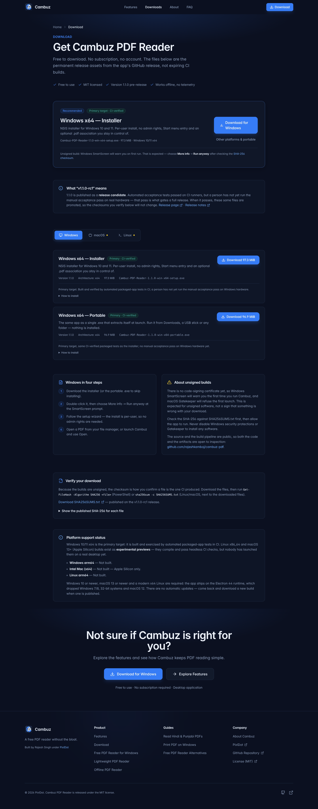
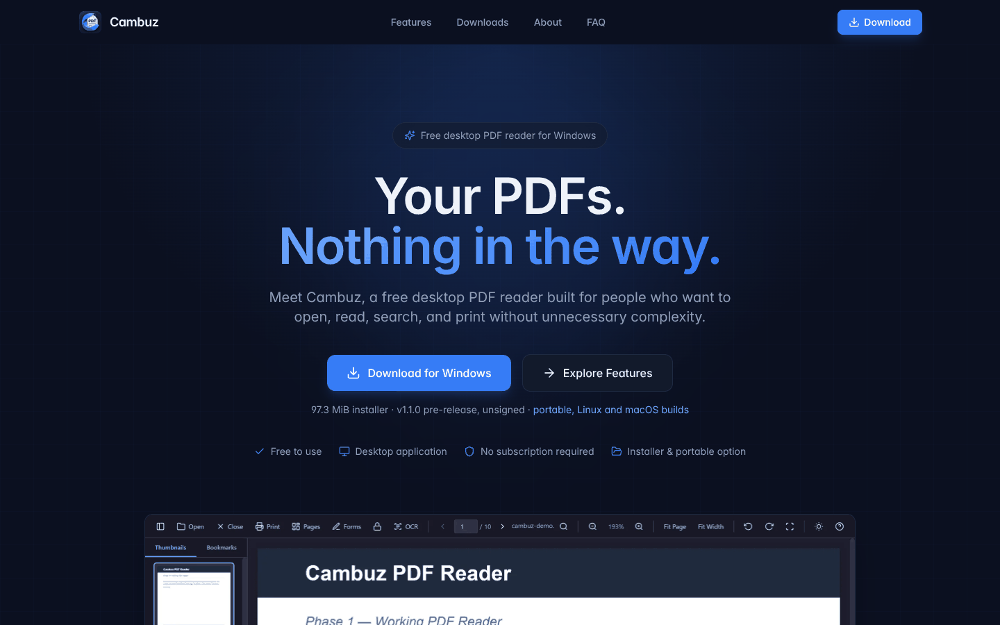
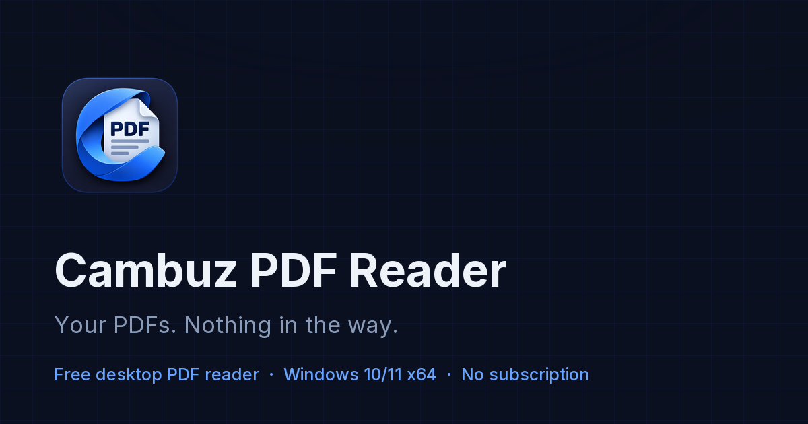

# Verification — download links, official icon, local render

Date: 2026-10-11 · Branch: `arena/a50adb20-cambuz-landing`

What was changed and how it was checked. Screenshots in
[`screenshots/`](screenshots/) are real captures of the running site, taken from
this branch's working tree.

## 1. Download links

The site now links directly to the **permanent release assets** of the Cambuz
PDF Reader `v1.1.0-rc1` pre-release. The tag is pinned in
`src/config/site.ts`; nothing on the site uses `/releases/latest`, because
GitHub excludes pre-releases from "latest" and it would not resolve to the
`-rc1` assets.

Verified against the GitHub Releases API:

```console
$ node scripts/update-release.mjs --check

v1.1.0-rc1 (pre-release, published 2026-10-11T16:50:03Z)
https://github.com/rajeshkamboj/cambuz-pdf/releases/tag/v1.1.0-rc1

file                                                        bytes  MiB
Cambuz-PDF-Reader-1.1.0-linux-x86_64.AppImage            97497590  93.0
Cambuz-PDF-Reader-1.1.0-mac-arm64.dmg                   111866296  106.7
Cambuz-PDF-Reader-1.1.0-mac-arm64.zip                   116810366  111.4
Cambuz-PDF-Reader-1.1.0-win-x64-portable.exe            101614299  96.9
Cambuz-PDF-Reader-1.1.0-win-x64-setup.exe               102032148  97.3
SHA256SUMS.txt                                                539  0.0

OK: all 5 advertised files exist with matching sizes.
```

Every rendered link was also read back out of the live DOM and checked to be an
absolute `…/releases/download/v1.1.0-rc1/<exact-file-name>` URL — on the home
page, the download page (all three platform tabs) and the Windows landing page.
The artifact byte sizes in `src/config/site.ts` are the exact values the API
reports; the SHA-256 values are the ones published in the release's
`SHA256SUMS.txt`, so the "Verify your download" table cannot drift from the
release silently.

The app's own README was used as the source of truth for copy. Two claims were
corrected (see `docs/screenshots.md`):

| Where | Was | Now |
| ----- | --- | --- |
| `src/data/faq.ts` | "No. Cambuz does not include optical character recognition." | Optional local OCR via a Tesseract you install yourself; scanned PDFs stay image-only without it |
| `src/pages/LightweightPage.tsx` | "No OCR (optical character recognition)" | "No bundled OCR engine — optional local Tesseract only" |
| `src/pages/AlternativesPage.tsx` | listed OCR, page merging/splitting/reordering and form filling as reasons to use another tool | those are implemented; the list now covers editing, annotation, conversion, signatures, XFA forms and cloud features instead |

Nothing on the site claims Windows arm64, Intel Mac or Linux arm64 builds exist,
nor that the Linux/macOS builds have been run by a person, nor that the
pre-release has passed manual acceptance.

## 2. Official icon

- `public/favicon.svg`, `public/logo.svg` and `public/og-image.svg` were the
  hand-drawn approximations. They are **deleted**, and `grep` confirms nothing
  references them any more (the only remaining mentions were in
  `docs/screenshots.md`, which is updated).
- In their place: 16/32/48 PNGs + a multi-resolution `favicon.ico` (16, 32, 48),
  `apple-touch-icon.png` (180), `icons/icon-192.png`, `icons/icon-512.png`,
  `icons/maskable-icon-512.png`, `icons/logo-mark-128.png` and
  `icons/logo-mark-256.png` — all generated from the official
  `assets/icon-master.png` (1254 × 1254, the same master the desktop app
  packages from) by `scripts/generate-icon-assets.py`.
- The social card is `public/social/og-image.png` (1200 × 630) with a square
  variant, generated by `scripts/generate-og-image.py`.
- The header and footer wordmark is now the official mark **plus real HTML
  text** in the site's own font (see `src/components/Logo.tsx`), so it scales
  with the interface, stays selectable and remains readable to search engines.
  The image lockups from the asset brief are deliberately not used.
- `index.html` carries absolute `og:image` / `twitter:image` URLs pointing at
  `https://cambuz.pixldotcom…` → corrected to the site's real origin,
  `https://cambuz.pixldot.com`, in both `index.html` and `site.webmanifest`;
  `src/hooks/useSeo.ts` re-sets them per route.

The generated icon set, including how it looks at 16 px and on a masked
launcher:


## 3. The site rendered locally

`npm install` → `npx vite --host 0.0.0.0 --port 5173` → headless Chromium at
1440 × 900 and 390 × 844 (the page's own screenshots, nothing hand-drawn):

| Screenshot | What it shows |
| ---------- | ------------- |
| [`home-desktop.png`](screenshots/home-desktop.png) | Hero with the official mark, the direct installer link and the "97.3 MiB installer · v1.1.0 pre-release, unsigned" line |
| [`download-desktop.png`](screenshots/download-desktop.png) | Download page: recommended card, `v1.1.0-rc1` explainer |
| [`download-desktop-full.png`](screenshots/download-desktop-full.png) | The whole download page, including verification and platform status |
| [`download-desktop-macos-tab.png`](screenshots/download-desktop-macos-tab.png) | The macOS tab after clicking it — experimental badges and Gatekeeper instructions |
| [`download-desktop-linux-tab.png`](screenshots/download-desktop-linux-tab.png) | The Linux tab's AppImage card |
| [`download-verify.png`](screenshots/download-verify.png) | The verification block and the platform support status list |
| [`download-mobile.png`](screenshots/download-mobile.png) | 390 px wide: no horizontal overflow after the tab-bar fix |
| [`windows-desktop.png`](screenshots/windows-desktop.png) | `/free-pdf-reader-windows/` with per-build download buttons |







Checks run on this branch:

```console
$ npm run typecheck   # tsc --noEmit -p tsconfig.app.json — clean
$ npm run lint        # eslint . — clean (11 pre-existing errors also fixed)
$ npm run build       # vite build — clean, icons/manifest/social copied into dist/
$ node scripts/update-release.mjs --check   # OK: all 5 advertised files exist
```

Behaviour checked in the browser session: no console errors or page errors on
any route; the Windows/macOS/Linux tabs each swap the card list and the
installation guide; `scrollWidth === clientWidth` at 1440, 390 and 320 px on
`/download/`.

### Known limits of this verification

Recorded so nobody mistakes it for more than it is:

- The capture environment has **no route to `fonts.gstatic.com`**, which is
  where `src/index.css` loads Inter. The harness served the same Inter files
  from the npm `inter-ui` package in their place, so text metrics are right —
  but the deployed site fetches the real Google Fonts files, and a totally
  missing font would fall back to the system stack.
- Screenshots come from headless Chromium (the `@sparticuz/chromium` build) in
  a sandbox, not from a full desktop browser. Layout is real; scrollbars,
  subpixel antialiasing and OS font smoothing are not.
- Checked at 1440 × 900, 390 × 844 and 320 × 800 only. No tablet-width pass, no
  Safari or Firefox pass and no screen-reader pass.
- No page was printed and no Lighthouse/Core Web Vitals run was made.
- The download links were verified with the API and in the DOM. They were not
  clicked end to end in a real browser session, and the binaries were not
  downloaded and hash-checked here (the release's own numbers were used).
